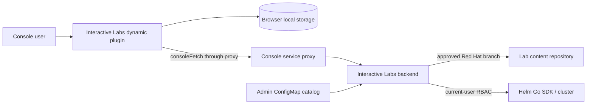
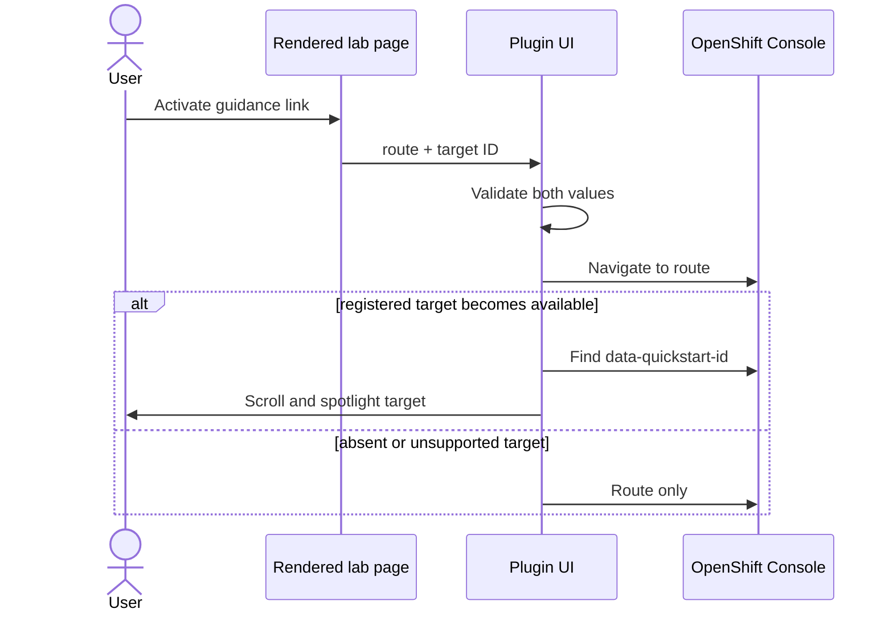

# Architect Notes — Interactive Labs

## Overview

Interactive Labs adds guided, multi-page tasks to OpenShift Console without turning Console, browser, or lab authors into cluster administrators. This note designs client side of MVP and records backend contracts client requires. Product goal and acceptance criteria remain in [proposal.md](proposal.md).

Evidence: `proposal.md`; SANDBOX-1998 through SANDBOX-2005; OpenShift Console Dynamic Plugin documentation. Repository has no source, `docs/`, tests, or plugin scaffold. File paths below are target structure, not existing code.

## Design Principles

- **Console-native.** Use Dynamic Plugin SDK, Console navigation, `consoleFetch`, Console service proxy, and existing `data-quickstart-id` targets. Do not recreate Console routing or Quick Starts.
- **Browser is untrusted.** Client never clones arbitrary repositories, runs Helm, stores user tokens, or decides authorization.
- **Content is data, not code.** Lab content comes only from catalog-approved Red Hat branches. MVP does not detect, reconcile, or migrate upstream content updates. Rendering permits only lab-local documents, known link directives, and checkpoint metadata (`type: manual` in MVP).
- **Explicit user intent.** User confirms namespace selection and manual progress. Navigation never marks progress complete.
- **Small MVP.** One lab path, one optional prerequisite chart, local progress, and synchronous bounded setup. No background worker, CRD, namespace creation, user cancellation, or automated solving.
- **Recoverable failures.** Every lab-content, setup, render, route, and verification failure gives user an actionable manual next step. MVP never retries, cleans up, or recovers Helm automatically.
- **Accessible overlay.** Keyboard operation, focus management, semantic controls, and non-pointer spotlight dismissal are baseline requirements.

## Architecture / How It Works

### Deployment boundary

Console loads browser assets from Dynamic Plugin service. Plugin calls backend only through its declared `UserToken` Console service proxy using `consoleFetch`; backend receives current user's forwarded access token, derives authenticated identity, and performs repository access and Helm operations with current-user RBAC. Dynamic-plugin proxy configuration uses a HTTPS Service endpoint. Backend must not persist or log forwarded tokens. Deployment declares one tested OpenShift Console/Dynamic Plugin SDK compatibility range.



### Backend MVP contract

Backend exposes three operations through the declared `UserToken` Console service proxy. Transport paths are implementation detail; operation semantics below are MVP contract.

| Operation | Client input | Backend requirements | Result |
| --- | --- | --- | --- |
| **List catalog** | None | Read admin-configured approved catalog entries. | Catalog entries or typed catalog/configuration error. |
| **Load lab bundle** | Selected catalog lab ID | Resolve configured repository and branch server-side; validate supported manifest `apiVersion`; load manifest, pages, lab-local includes, and optional chart as one bundle; reject paths outside lab tree. | Validated bundle plus runtime context, or typed content/version/repository error. |
| **Setup lab** | Selected lab ID and confirmed namespace bindings | Revalidate catalog, bundle, namespace bindings, current-user access, release ownership, and chart inputs. Derive release identity server-side, then run Helm synchronously with `Wait` and bounded timeout. | Terminal `success`, `failure`, or `timeout`, with safe actionable error context. |

Backend must treat catalog repository, branch, lab path, Helm release identity, and authorization identity as server-derived values. Client input must not override them. Forwarded user tokens are request-scoped only: backend must neither persist nor log them.

MVP has no setup cancellation, automatic retry, cleanup, recovery, asynchronous status, durable lab-session state, automated completion verification, or section-solving API. A terminal setup error can leave Helm resources behind and requires manual user or administrator intervention.

### Launch and setup flow

1. Plugin lists catalog entries and asks backend for selected lab's validated manifest and complete lab bundle from its configured branch.
2. Plugin validates client-facing manifest shape before using it. Backend remains trust boundary for catalog, branch, paths, and lab-content retrieval. Page navigation uses loaded bundle; MVP does not check upstream changes during session.
3. Plugin derives namespace fields from manifest; it preselects current Console namespace only after client/server validation and always asks user to confirm.
4. Backend derives stable Helm release identity from authenticated user subject, lab ID, configured branch, and normalized namespace bindings: `il-` plus a truncated SHA-256 digest of their canonical representation. Client never supplies release identity; backend derives expected identity again before reusing a release.
5. Plugin calls setup only after confirmation. MVP backend invokes Helm synchronously with `Wait` and bounded timeout, then returns typed final result: `success`, `failure`, or `timeout`.
6. On success—or immediately for lab without chart—plugin opens first page. Any terminal setup error preserves selected context and requires manual intervention by user or administrator. Client neither retries nor guesses cleanup.

MVP uses one bounded request and an indeterminate accessible progress state, not a progress protocol. Closing, minimizing, or resetting panel does not cancel setup. Client exposes no Cancel control: Helm `Install.RunWithContext` can return on context cancellation while a started install continues in background, so cancellation does not reliably mean stop. Backend returns enough error detail to explain RBAC, repository, chart, and timeout failures.

```mermaid
sequenceDiagram
  actor User
  participant UI as Plugin UI
  participant API as Backend through Console proxy

  User->>UI: Select lab
  UI->>API: Get validated manifest
  API-->>UI: Manifest + runtime context
  UI->>User: Select and confirm namespace(s)
  User->>UI: Start lab
  UI->>API: Setup(namespace bindings)
  API-->>UI: success | failure | timeout
  alt success or no chart
    UI->>User: Open first lab page
  else failure or timeout
    UI->>User: Explain outcome; retain selection
  end
```

### Content, routes, and spotlight flow

Plugin renders AsciiDoc in browser through Asciidoctor.js with a restricted, documented profile, then sanitizes generated DOM output. Lab-local includes and inter-page links resolve only through normalized paths present in the loaded bundle, relative to its `content/` root. Backend loads `.adoc` source files recursively. A path with any segment beginning `_` is include-only and cannot be a navigation target; remaining paths sort lexically, with first path as entry page and adjacent paths as previous/next navigation. Runtime attributes supplied by backend override author attributes. Remote includes, executable extensions, arbitrary filesystem access, raw HTML outside supported subset, external navigation directives, and arbitrary DOM selectors are rejected.

Asciidoctor safe-mode choice alone does not establish browser XSS safety. Sanitizer policy and permitted AsciiDoc subset are versioned authoring contract; fixture lab defines first supported subset.

A Quick Start-compatible AsciiDoc macro authors each Console guidance link and carries a same-Console route plus optional symbolic target ID. Plugin translates it to a typed instruction, then validates route and target against Console-supported Quick Start addressing. It navigates first, waits for target render, then finds matching `data-quickstart-id`, scrolls it into view, and displays spotlight. Missing or unsupported target falls back to route-only navigation. Dismiss spotlight on target interaction, Escape, route change, or timeout.



### Panel and progress flow

Overlay state contains active lab/version, current page, panel mode (`open` or `minimized`), namespace bindings, and local section progress. Closing hides panel; reopening restores valid state. Reset removes only this browser state. It does not call cleanup, stop setup, delete cluster resources, or alter any future audit record.

MVP has no automated or cluster-state verification. A section can expose an explicit `type: manual` checkpoint; its `Confirmed` state is local user attestation, not evidence that instructions were completed. Neither page visit nor cached page state can manufacture confirmation. Browser-local state is MVP boundary: clearing browser storage or switching browser/device loses checkpoint state. Automated verification and durable progress are deferred.

## Core Concepts

| Concept | Role | Client responsibility |
| --- | --- | --- |
| **Catalog entry** | Admin-visible lab locator: approved Red Hat repository, branch, AsciiDoc path, optional chart path. | List, select, display availability/error. Never dereference arbitrary URLs. |
| **Lab manifest** | Versioned lab-content contract: attributes, optional setup, links, and typed `checkpoints`. Page paths and entry order derive from loaded content. | Validate schema before use; render only supported features. |
| **Lab session** | Loaded lab bundle plus browser-local state for one selected lab and namespace bindings. | Navigate within loaded bundle; persist/restore panel and progress state. |
| **Namespace binding** | Explicit mapping from chart release namespace or annotated chart value to existing user-accessible namespace. | Preselect only when valid; require confirmation; pass binding unchanged to backend. |
| **Helm release identity** | Server-derived identity for one user's deployment of one configured lab branch into one normalized set of namespace bindings. | Never generate, persist as authority, or submit it; use it only as backend-provided correlation context. |
| **Setup result** | Final backend result for optional Helm prerequisite installation. | Show typed status and safe next action. |
| **Lab page** | One lab-local AsciiDoc page. | Resolve allowed relative links; show loading, missing-page, malformed-content states. |
| **Console guidance link** | Typed `{ route, targetId? }` instruction using Console-supported Quick Start addressing, not URL/selector escape hatch. | Validate, navigate, attempt spotlight, fallback safely. |
| **Checkpoint** | Typed section-progress marker; MVP supports only `type: manual`, explicit user confirmation. | Persist local `Confirmed` state; never present it as automated verification. |

### Lab content delivery

Catalog identifies a lab by canonical approved Red Hat repository identity and branch. Browser never fetches repository content. At lab launch, backend loads manifest, pages, includes, and optional chart from that branch into one bundle and rejects paths outside lab tree. Helm dependencies may resolve at runtime from sources declared by approved chart; catalog approval trusts those declarations. MVP does not expose resolved revision, detect an upstream update, migrate state, or reconcile running labs after upstream content changes.


### Namespace model

A chart's Helm release namespace is always an explicit user-confirmed selector. Additional selectors come only from chart `values.schema.json`: every field annotated with `x-interactive-labs: { "kind": "namespace-name" }` is a namespace input. Its JSON-property path is binding key; standard `title`, `description`, and `required` drive UI. Other `values.yaml` fields need no schema entry and remain allowed because schema does not set `additionalProperties: false`.

Client asks user to bind each selector to an existing namespace. Current Console namespace may preselect only when accessible and permitted. Client must not create namespaces or choose one silently. Multiple selectors may choose same namespace; MVP does not add cross-field distinction rules.

### State ownership

| State | Owner | Persistence |
| --- | --- | --- |
| Catalog validation, lab-content retrieval, setup, authorization | Backend | Backend-defined operational state |
| Current user/namespace/routing | OpenShift Console | Console |
| Overlay/page/minimized state and local checkpoint state | Plugin | Namespaced browser local storage |
| `type: manual` checkpoint | Plugin | Browser local storage; user attestation only |

Local storage key must include lab identity and configured branch. On manifest incompatibility or reset, discard incompatible client state rather than attempting migration.

### Future asynchronous setup

Asynchronous setup is feasible without a durable operation ID: Helm release identity is correlation key, and Helm release state is source for later status/recovery. One release may have zero or one active deployment. A future `POST /setup` can return while backend runs; a later authenticated browser request with a fresh token asks for same release state or explicitly re-deploys it. That future work is independent of upstream branch-update handling.

That future path needs release-scoped mutual exclusion across backend replicas—Kubernetes `Lease` is smallest durable option—and a server-side deadline. While lease is held or Helm reports `pending-*`, response is `in_progress`; expired/missing lease plus pending release is abandoned and requires explicit user-authorized recovery. No token, operation log, or cancellation record needs persistence. This remains future work; MVP is synchronous.

## Implementation Plan

### Phase 1 — Establish plugin shell and contracts

- Bootstrap from supported OpenShift Console Dynamic Plugin template; declare ConsolePlugin asset hosting and HTTPS service proxy.
- Pin compatible Dynamic Plugin SDK and PatternFly/Console dependency set; use SDK hooks rather than directly sharing QuickStart React context across plugin boundary.
- Define TypeScript schemas for catalog view, `v1alpha1` manifest view, setup result, chart namespace annotations, guidance links, typed checkpoints, and persisted session.
- Backend and plugin reject unsupported manifest `apiVersion`; agree error envelope before UI implementation. No migration framework in MVP.

### Phase 2 — Lab launch and overlay

- Build catalog selection, validated manifest fetch, namespace confirmation, and bounded setup UX.
- Build accessible overlay shell with open/minimize/close/reset and browser-state restore.
- Test keyboard/focus behavior and all setup error states.

### Phase 3 — Render and navigate content

- Add restricted Asciidoctor.js adapter with lab-local page/include resolver and runtime-attribute precedence.
- Add page navigation, invalid content/missing-page states, and typed Console guidance links.
- Implement route-first spotlight adapter around allow-listed `data-quickstart-id` targets.

### Phase 4 — Verify and harden representative lab

- Render explicit `type: manual` checkpoints; navigation alone must never confirm a section. Defer other checkpoint types until their contracts are designed.
- Add unit tests for schema/link/state rules, component tests for overlay/render/error states, accessibility tests, proxy/backend integration tests, and an OpenShift smoke test.
- Publish author/admin contract, supported Console range, RBAC needs, recovery guidance, and one complete fixture lab.

## Deferred to V2

- **Lab author validation tool.** Validate lab content, manifest, chart `values.schema.json` namespace annotations, and Helm chart before publication.
- **Automated verification.** Add non-manual checkpoint types through a general, non-ad-hoc evidence/check contract.
- **Asynchronous setup lifecycle.** Add release lease, status/recovery UI, and server-side deadline when synchronous setup no longer meets user needs.
- **Upstream-content lifecycle.** Add revision visibility, update notification, migration/reconciliation, and rollback behavior for branch-delivered lab content.
- **Offline/change-controlled delivery.** Add digest-published lab content for disconnected or tightly governed clusters.

## Open Questions

## ✔ Q1: Proxy authorization and compatibility target

Dynamic Plugin proxy configuration determines what reaches backend and which Console/SDK APIs plugin can rely on.

### Option A: `UserToken` proxy authorization with one declared OpenShift/Console compatibility range
- **Pro:** Meets current-user RBAC requirement; smallest support/test matrix.
- **Con:** Requires backend token handling discipline and range upgrades.

**Decision:** Option A — use `consoleFetch`, avoid token persistence/logging, and publish one tested compatibility range.

_Considered and rejected: Option B (adds privileged identity and impersonation risk while breaking direct user-RBAC execution.)_

## ✔ Q2: Setup retry and partial-install lifecycle

A timed-out or failed Helm operation can leave resources behind. A client retry or cleanup request cannot be treated as harmless without a chart-specific recovery contract.

### Option C: No automatic retry in MVP
- **Pro:** Avoids accidental duplicate setup, hidden cleanup, and unsafe recovery assumptions.
- **Con:** Every terminal setup error needs user or administrator intervention before a new request.

**Decision:** Option C — MVP never retries, cleans up, or recovers Helm automatically. User or administrator diagnoses and remediates the error; any later explicit setup request uses a fresh token and backend release-state checks.

_Considered and rejected: Option A (would imply productized recovery policy before chart lifecycle is defined), Option B (can compound partial installs and hides cleanup responsibility.)_

## ✔ Q3: Rendered-content trust and sanitization

Pinned repositories reduce supply-chain drift but do not make HTML emitted into Console safe by default. This decision sets content-author capability.

### Option A: Strict authoring subset plus DOM sanitization
- **Pro:** Best XSS boundary; portable and testable contract.
- **Con:** Limits rich AsciiDoc/HTML features and needs sanitizer configuration.

**Decision:** Option A — support only fixture-lab AsciiDoc subset, sanitize rendered DOM, and expand author capability only after security review.

_Considered and rejected: Option B (approved repository compromise can inject into Console), Option C (cross-frame navigation, styling, and accessibility complexity.)_

## ✔ Q4: Guidance-link syntax and target registry owner

Authors need stable links while Console DOM remains private implementation. Console's Quick Start addressing is supported; any other content-addressing mechanism is unsupported and unstable.

### Option A: Quick Start-compatible AsciiDoc macro and Console-supported target registry
- **Pro:** Typed, lintable, and stable within supported Console contract; no raw routes/selectors; target behavior matches Quick Starts.
- **Con:** New target support follows Console/Quick Start support and may require plugin release.

**Decision:** Option A — lab guidance uses Quick Start-compatible symbolic target IDs mapped to supported route and `data-quickstart-id` behavior. Unsupported target ID falls back to route-only navigation.

_Considered and rejected: Option B (author-controlled target definitions cannot guarantee supported/stable Console addressing), Option C (arbitrary selectors/routes are unsupported and unstable.)_

## ✔ Q5: Verification declaration and section completion

Arbitrary manifest checks would become an ad-hoc and increasingly complex execution language as labs require richer verification.

### Option C: Typed checkpoints; manual only in MVP
- **Pro:** Smallest honest implementation; no premature check DSL or unsafe arbitrary cluster query surface.
- **Con:** `Confirmed` records user attestation only; it does not prove instructions were completed.

**Decision:** Option C — `checkpoints` is a typed extension point; MVP accepts only explicit local `type: manual` checkpoints. Navigation never confirms a section. Non-manual types are deferred until a general, non-ad-hoc contract is designed.

_Considered and rejected: Option A (typed check definitions still grow into an ad-hoc DSL as requirements expand), Option B (couples renderer and execution semantics.)_

**Scope impact:** This defers SANDBOX-2004's observable-check acceptance criteria. Update that story before treating MVP as complete.

## ✔ Q6: Progress durability and audit scope

Browser-local state satisfies close/reopen on one browser but disappears on cleared storage and does not support instructors/audit.

### Option A: Browser-local only for MVP
- **Pro:** Matches current scope; no new storage, identity, or privacy system.
- **Con:** No cross-device resume or audit trail.

**Decision:** Option A — store panel state and `type: manual` checkpoint state only in browser local storage. Do not claim durable completion history.

_Considered and rejected: Option B (adds persistence, authorization, retention, and reset semantics before MVP needs them.)_

## ✔ Q7: Namespace requirement and binding rules

Charts can target one release namespace and, through values, additional namespaces. Lab authors must declare those inputs once without duplicating them in lab manifest.

### Option A: Chart `values.schema.json` annotations define namespace inputs
- **Pro:** One chart-local source; client can build explicit namespace selectors without brittle template inference; unrelated `values.yaml` entries need no schema definition.
- **Con:** Introduces small Interactive Labs `x-interactive-labs` annotation convention that backend must validate.

**Decision:** Option A — every chart uses explicit release namespace selection. Additional namespace inputs are `values.schema.json` fields with `x-interactive-labs: { "kind": "namespace-name" }`; property path is binding key and standard JSON Schema UI metadata drives selector. Multiple inputs may select same namespace. Lab manifest does not list namespaces.

_Considered and rejected: manifest namespace lists (duplicates authoring), template/dry-run inference (validates output but cannot reliably discover user inputs.)_

## ✔ Q8: Manifest and API evolution policy

Plugin, backend, and lab content update independently. Version mismatch must fail predictably rather than partially render or install.

### Option A: Semantic manifest `apiVersion`; backend rejects unsupported versions; plugin rejects unsupported capabilities
- **Pro:** Clear compatibility/error behavior; permits additive evolution.
- **Con:** Needs schema/version maintenance.

**Decision:** Option A — support one `v1alpha1` manifest in MVP. Backend and plugin reject unsupported versions; no general migration framework.

_Considered and rejected: Option B (branch-delivered lab content could silently break as format evolves.)_

## ✔ Q9: Lab repository and Helm dependency delivery

Red Hat authors labs, but many independent customer clusters consume them. Requiring each customer administrator to promote every content fix defeats centrally maintained lab content.

### Option B: Catalog references approved Red Hat branch; MVP does not handle upstream updates
- **Pro:** Smallest author and customer workflow; Red Hat can update branch without customer ConfigMap edits.
- **Con:** No reproducibility, update notification, migration, rollback, or running-lab reconciliation guarantee beyond content already loaded for current overlay.

**Decision:** Option B — MVP references approved Red Hat branch and loads one lab bundle at launch. It does not pin or surface commit IDs, observe/update active sessions, or reconcile content changed upstream. Helm dependencies may resolve at runtime from sources declared by approved chart; catalog approval trusts those declarations.

_Considered and deferred: Option A (per-customer commit promotion), Option C (digest-packaged/offline distribution), branch-to-commit session snapshots and upstream-update lifecycle management._
