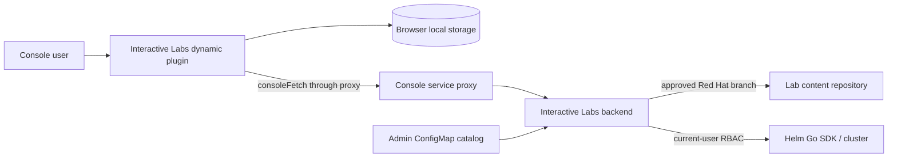

# Architect Notes — Interactive Labs

## Overview

Interactive Labs adds guided, multi-page tasks to OpenShift Console without turning Console, browser, or lab authors into cluster administrators. This note designs client side of MVP and records backend contracts client requires. Product goal and acceptance criteria remain in [proposal.md](proposal.md).

Evidence: `proposal.md`, `stories.md`, repository source and tests, and OpenShift Console Dynamic Plugin documentation. This note mixes implemented behavior and provisional design; current author contract is [lab content contract](../../docs/lab-content-contract.md), and current setup flow is [lab setup design](../../docs/lab-setup-design.md).

## Design Principles

- **Console-native.** Use Dynamic Plugin SDK, Console navigation, `consoleFetch`, Console service proxy, and existing `data-quickstart-id` targets. Do not recreate Console routing or Quick Starts.
- **Browser is untrusted.** Client never clones arbitrary repositories, runs Helm, stores user tokens, or decides authorization.
- **Content is data, not code.** Lab content comes only from catalog-approved Red Hat branches. STORY-10 service-account refresh replaces validated snapshots on an administrator-configured cadence with default concurrency four and a ten-minute per-source deadline; ticks skip while prior sweep remains active. `go-git` checkout always uses private staging, so deadline cancellation cannot corrupt published content; backend never invokes or packages a Git executable for any Git-related operation. It does not notify, reconcile, or migrate active content. Rendering navigates only `labPath/content` pages and loads same-repository supporting resources through backend-approved URLs. The current `type: manual` checkpoint proposal is provisional pending evidence and checkpoint rules.
- **Explicit user intent.** Current chart setup provisions namespaces through SpaceRequests; existing-namespace selection remains a provisional proposal, not current UI. Selection/lifecycle policy remains open. Navigation must not claim progress completion.
- **Small MVP.** One lab path and one optional repository-root prerequisite chart. Current chart setup creates SpaceRequests and runs a bounded asynchronous Helm worker; no user cancellation, automatic cleanup, or automated solving. Browser-local manual progress remains a provisional candidate, not a settled completion model.
- **Recoverable failures.** Every lab-content, setup, render, route, and verification failure gives user an actionable next step. Setup worker retries transient readiness checks; an expired Lease allows verified no-release setup to restart using a fresh user token. Unsafe Helm states still need administrator intervention; no automatic cleanup or user cancellation exists.
- **Accessible overlay.** Keyboard operation, focus management, semantic controls, and non-pointer spotlight dismissal are baseline requirements.

## Architecture / How It Works

### Deployment boundary

Console loads browser assets from Dynamic Plugin service. Plugin calls backend only through its declared `UserToken` Console service proxy using `consoleFetch`; backend receives current user's forwarded access token, derives authenticated identity, and performs repository access and Helm operations with current-user RBAC. Dynamic-plugin proxy configuration uses a HTTPS Service endpoint. Backend must not persist or log forwarded tokens; async setup worker holds the forwarded token in memory beyond POST response. Deployment declares one tested OpenShift Console/Dynamic Plugin SDK compatibility range.



### Backend MVP contract

Backend exposes catalog, bundle, resource, setup, and setup-status operations through the declared `UserToken` Console service proxy.

| Operation | Client input | Backend requirements | Result |
| --- | --- | --- | --- |
| **List catalog** | None | Read admin-configured approved sources; derive `catalogRef`; return validated `lab.yaml` `metadata.title`, optional `description`, and normalized `labPath`. Unavailable, missing-manifest, or invalid labs are omitted; unsafe configuration is typed `configuration_error`. | Ordered valid catalog entries or typed error. |
| **Load lab bundle** | Selected `catalogRef` | Resolve approved snapshot, validate `v1alpha1` manifest and modules; return `manifest`, `runtimeContext`, and ordered `modules: [{id, pages: [{path, url}]}]` with module-qualified paths and approved backend-relative URLs. No flat `pages` or checkpoint payload. | Validated bundle or typed error. |
| **Read resource** | Selected `catalogRef` and repository-relative path | Authorize and constrain to approved repository snapshot, including module pages and same-repository includes/images. | Resource bytes with private cache headers or typed error. |
| **Start/check setup** | Selected `catalogRef` | Create/reuse verified dedicated current-user SpaceRequests, start async Helm worker on POST, reconstruct status on GET. | `SetupStatus` (`POST /setup`, `GET /setup/status`) or typed error. |
| **List/tear down setup** | Selected server-listed `catalogRef` and confirmation generation | Discover current-user identity-marked SRs/releases without current catalog; serialize against setup, uninstall Helm, UID-conditionally delete dedicated SRs. | `SetupList` / `TeardownResult` or typed error. |

Backend derives catalog repository, branch, lab path, Helm release identity, and authorization identity; client cannot override them. Forwarded user tokens must not be persisted or logged; current setup worker retains token in memory while running. No silent Helm reinstall/cleanup, user cancellation, durable lab-session state, automated completion verification, or section-solving API. A terminal Helm failure can leave resources behind and require manual intervention when verified cleanup is unsafe.

### Launch and setup flow

1. **Implemented backend behavior:** Catalog, bundle, setup, and resource loading share one immutable configured repository/branch snapshot at `/var/lib/interactive-labs/cache/<sha256 canonical repository+branch>/content`. `Close` preserves it; no PVC is mounted today, so pod/container replacement loses cache. A future PVC mounts this fixed path. Catalog metadata comes from each validated manifest; resource route serves approved snapshot bytes.
2. **Implemented frontend behavior:** Plugin validates manifest, normalized `labPath`, modules, module-qualified page descriptors, and exact resource URLs before using them. Backend remains trust boundary for catalog, branch, paths, and lab-content retrieval. Client resolves URLs through known Console proxy base. Navigation uses descriptor membership across modules; rendering fetches only approved resource paths. MVP does not check upstream changes during session.
3. Namespace-selection/lifecycle policy remains open. Existing-namespace selection is a provisional proposal, not current behavior: chart-backed setup currently derives SpaceRequests from repository-root schema annotations and uses current-user RBAC.
4. Backend derives stable Helm release identity from authenticated user, `catalogRef`, and namespace bindings. Client never supplies release identity.
5. Labs without charts open first page of first module. Chart-backed launches POST setup, poll status, then open content when provisioned/deployed. Module title requests start in background after setup; selector shows literal IDs until plain-text first-page titles are available.

**Current setup flow:** chart-backed launch POSTs setup without namespace bindings, then polls setup status while SpaceRequests provision and worker installs Helm. UI shows progress and opens content only when ready/deployed; failures surface to user. Closing panel does not cancel worker. Worker may be lost on process restart; its renewable reservation becomes eligible for best-effort takeover 200 seconds after last renewal. With no Helm release, a new authenticated POST resumes setup from verified SRs; a safe interrupted pending install needs explicitly confirmed teardown before relaunch. [Lab setup design](../../docs/lab-setup-design.md) documents this flow.

### Content, routes, and spotlight flow

**Implemented and verified:** Plugin renders AsciiDoc in browser through exact pinned Asciidoctor.js, DOMPurify, highlight.js, and Mermaid dependencies. DOMPurify's final AsciiDoc pass uses its default allowlist (HTML, SVG, SVG filters, and MathML) and forbids `style`/`form` elements and `style` attributes; Mermaid SVG receives a separate SVG/SVG-filter-profile pass and is inserted afterward. No custom allowlist or hook is configured. Catalog supplies normalized `labPath`, allowing client to form `lab.yaml` base while description remains raw text. Bundle supplies normalized navigable page paths and backend-relative approved resource paths; client resolves only through its declared Console proxy base. Asciidoctor's include processor requests same-repository includes through `GET /api/v1alpha1/labs/{catalogRef}/resources/{repositoryRelativePath...}`; images use route after inert HTML `src` rewrite. Relative image targets use flattened-document top-level page base. Resource handler has no size caps; it uses a quoted cached snapshot Git-HEAD SHA as `ETag` and `Cache-Control: private, no-cache`. A `_`-leading path segment is include-only. Modules and their navigable content-relative `.adoc` paths sort bytewise. First page of first module is entry; Previous/Next spans module boundaries while counter is module-local. Backend runtime attributes are passed hard-set to Asciidoctor and override author attributes. Renderer enforces include depth 64 and adds no include-count or aggregate-content cap.

Relative links resolve by browser URL semantics from active source and navigate drawer only when result exactly matches known page descriptor. Same-page fragments remain anchors. Absolute HTTP(S) targets outside Console origin open safe new tab; same-origin non-plugin-proxy targets use native Console navigation while drawer remains open. Plugin proxy/resource targets and unknown relative pages warn rather than navigate. A validated description page link explicitly launches target after bundle validation without bypassing chart setup. Remote includes, executable extensions, arbitrary filesystem access, repository-root escapes, raw HTML outside supported subset, and arbitrary DOM selectors are rejected.

Asciidoctor safe mode alone does not establish browser XSS safety. Initial fixture supports syntax-highlighted source blocks and Mermaid diagrams, not arbitrary executable extensions or author-supplied SVG. Highlighting consumes text content and rejects unescaped HTML. Mermaid runs with strict security, no auto-start or click/callback binding; generated SVG receives separate DOMPurify SVG/SVG-filter-profile sanitization, which retains allowed Mermaid styles and SVG filter elements, after final AsciiDoc HTML sanitization. Recoverable rejected content/resources and Mermaid/highlighter failures render explicit inline warnings; page fetch, conversion, or sanitizer failures render safe actionable page error. Do not share Asciidoctor's global logger across concurrent page/description conversions.

**Implemented and verified:** `console:<quickstart-data-id>[label]` accepts only the fixed 25-ID Console registry; authors cannot provide a route or selector. Renderer emits fixed-route anchors with per-render provenance metadata. Plugin revalidates metadata, ID, and href before querying exact visible `data-quickstart-id` nodes. Route-backed IDs navigate once before waiting up to 10 seconds; visible-only IDs do not navigate. Found targets scroll into view and receive non-modal spotlight; target interaction, Escape, route change, timeout, panel close, unmount, or replacement cancels it. Drawer minimizes only when it horizontally overlaps target. `resource:` macros require two or three GVK components (`version/kind` or `group/version/kind`), enforce scope and attribute schema, and reject `namespace` with cluster scope. Each GVK component and every nonempty supplied `name`/`namespace` selector is URI-encoded into fixed derived same-origin Console resource list/details paths; Console resolves resource existence. Authors cannot supply routes or filter syntax. Resource links do not use spotlight.

```mermaid
sequenceDiagram
  actor User
  participant Page as Rendered lab page
  participant UI as Plugin UI
  participant Console as OpenShift Console

  User->>Page: Activate console:id[label]
  Page->>UI: renderer-provenanced target ID
  UI->>UI: Validate ID and fixed registry route
  alt absent route-backed target
    UI->>Console: Navigate to fixed route
  end
  UI->>Console: Find exact visible data-quickstart-id
  alt registered target becomes available
    UI->>User: Scroll and spotlight target
  else absent or unsupported target
    UI->>User: Announce unavailable; retain route fallback if navigated
  end
```

### Panel and progress flow

Overlay persists only `{currentPagePath, panelMode}` under per-`catalogRef` browser-local key. Closing hides panel; explicit relaunch restores a currently valid module-qualified page or starts at first page of first module. Route remount and browser refresh never auto-open the panel. Reset removes only browser state, never cluster resources or setup worker. Active module follows current page, including direct links/resume; selecting module opens its first page. A native dropdown appears only for multiple modules. Its labels begin as literal directory names and update in background after setup from first-page AsciiDoc titles with effective attributes, sanitized to inert text; missing/failed/empty titles retain name. Title lookup cannot block drawer or page loading.

Evidence, checkpoint, and completion rules remain open. Optional module-local `module.yaml` manual checkpoint data is validated but not included in bundle or displayed as progress. Browser-local user attestation remains a provisional idea, not current completion behavior. Automated verification, solver behavior, and durable progress remain deferred.

## Core Concepts

| Concept | Role | Client responsibility |
| --- | --- | --- |
| **Catalog entry** | Admin-visible lab locator: approved Red Hat repository, branch, lab path, and `lab.yaml` title/optional description. Chart lives at repository root. | List, select, render catalog description using `lab.yaml` base. Never dereference arbitrary URLs. |
| **Lab manifest** | `v1alpha1` lab-content contract: required `metadata.title`, optional description and string attributes. Module-local manual checkpoints live in optional `module.yaml`, not manifest or bundle. | Validate schema before use; render only supported features. |
| **Lab module** | Immediate safe directory under `modules/` with `content/` and ordered navigable pages. | Show module selector when multiple, derive active module from current page, navigate across modules. |
| **Lab session** | Loaded lab bundle plus per-`catalogRef` browser-local page path and panel mode. | Navigate within loaded bundle; persist/restore only valid page path and mode. |
| **Namespace binding** | Current setup derives annotated chart values from ready SpaceRequests; existing-namespace selection remains a separate proposal. | Do not treat provisional explicit selection as current UI or settled policy. |
| **Helm release identity** | Server-derived identity from user, `catalogRef`, and namespace binding keys. | Never generate, persist as authority, or submit it; use only as backend-provided correlation context. |
| **Setup status** | SpaceRequest and Helm phases from async setup. | Poll until ready/deployed or show failure. |
| **Lab page** | One lab-local AsciiDoc page. | Resolve allowed relative links; show loading, missing-page, malformed-content states. |
| **Console guidance link** | Renderer-generated `console:<quickstart-data-id>[label]` using fixed registry route/target behavior, not URL/selector escape hatch. | Revalidate, route only when registry requires it, attempt spotlight, fallback safely. |
| **Checkpoint** | Module-local validated `type: manual` authoring data, inert at runtime; completion model remains open. | Do not present user attestation as automated verification or settled completion evidence. |

### Lab content delivery

**Implemented and verified:** Catalog identifies a lab by canonical approved Red Hat repository identity and branch. Backend serves one immutable snapshot generation per identity from `/var/lib/interactive-labs/cache/<sha256 canonical repository+branch>/content` for catalog metadata, bundle, and setup loading while cache storage remains. Entry directory is reserved for future metadata. `Close` does not remove snapshots; current deployment has no PVC, so pod/container replacement or cache clearing permits a new snapshot. Future PVCs mount this fixed path. STORY-10 refreshes staged snapshots on a validated administrator-configured cadence (one-hour default), with validated distinct-source concurrency (default four), uses a ten-minute per-source deadline, validates configured lab paths before atomic publication, and uses `go-git` exclusively for clone, open, and revision operations; no Git executable is packaged or invoked. A scheduled tick skips while a prior sweep remains active, preventing stale snapshot publication. After a new Git revision clones and resolves its `HEAD`, an invalid lab path makes only that lab unavailable; valid siblings sharing source advance. A deadline-cancelled or failed staged checkout cannot corrupt a published snapshot. Source-acquisition failure (remote-ref lookup, clone, or Git `HEAD` resolution) produces one Warning Event per affected `(catalogRef, failure class)` for backend lifetime. Its structured log and Event annotations identify validated configured repository, branch, and lab path, but never token/header material, raw Git output, or lab content. An unavailable repository, missing manifest, or invalid lab is omitted from catalog with one Warning Event per `(catalogRef, reason)` for backend lifetime; its structured log and Event annotations carry the same validated source locator for direct operator diagnosis.

**Implemented and verified:** Cache metadata records resolved Git `HEAD` at atomic snapshot publication. Every resource representation from that snapshot returns the quoted commit SHA as common `ETag` with `Cache-Control: private, no-cache`; resource-size caps are not yet enforced, and revision is otherwise absent from catalog, bundle, and session data. Browser never selects repository or branch: it derives description `lab.yaml` base from server-provided normalized `labPath` and loads pages/includes/images only through backend-approved resource paths. At lab launch, backend reads manifest, navigable pages under `labPath/content`, and optional chart from cached approved snapshot; resource requests reject paths outside that repository. Helm dependencies may resolve at runtime from sources declared by approved chart; catalog approval trusts those declarations. STORY-10 refresh makes upstream changes visible only after full snapshot replacement; it does not migrate state or reconcile running labs.


### Provisional namespace direction

Namespace selection and lifecycle for single and multiple namespaces remain open. Current candidate uses an explicit release-namespace selector plus `values.schema.json` fields annotated `x-interactive-labs: { "kind": "namespace-name" }` for additional inputs. Property path would be binding key; standard `title`, `description`, and `required` would drive UI. This is not final authoring or lifecycle policy.

Current candidate asks user to bind each selector to an existing namespace and may preselect accessible current Console namespace. It does not create namespaces or choose them silently; multiple selectors may choose same namespace. Revisit these rules when resolving namespace policy rather than treating them as acceptance criteria.

### State ownership

| State | Owner | Persistence |
| --- | --- | --- |
| Catalog validation, lab-content retrieval, setup, authorization | Backend | Backend-defined operational state |
| Current user/namespace/routing | OpenShift Console | Console |
| Overlay/page/minimized state | Plugin | Namespaced browser local storage |
| Module-local checkpoint definitions | Lab source | Validated, not sent to browser; no attestation state |

Local storage key must include lab identity and configured branch. On manifest incompatibility or reset, discard incompatible client state rather than attempting migration.

### Current asynchronous setup limits

Current setup uses a background worker and status polling; forwarded token stays only in memory for worker lifetime. Setup and explicit teardown share a cluster-visible Lease reservation per user and `catalogRef`; different labs remain independent. Holders renew every 20 seconds; a 200-second lapse permits atomic best-effort takeover with resource rechecks, not guaranteed fencing of in-flight Helm work. Interrupted teardown reports unknown after expiry and requires fresh confirmation for any remaining verified resources. No durable execution journal exists. Teardown inventory is catalog-independent; chart files may be shared, installed releases and SRs never are. See [lab setup design](../../docs/lab-setup-design.md).

## Implementation Plan

### Phase 1 — Establish plugin shell and contracts

- Bootstrap from supported OpenShift Console Dynamic Plugin template; declare ConsolePlugin asset hosting and HTTPS service proxy.
- Pin compatible Dynamic Plugin SDK and PatternFly/Console dependency set; use SDK hooks rather than directly sharing QuickStart React context across plugin boundary.
- Define TypeScript schemas for catalog view, `v1alpha1` manifest view, setup result, chart namespace annotations, guidance links, typed checkpoints, and persisted session.
- Backend and plugin reject unsupported manifest `apiVersion`; agree error envelope before UI implementation. No migration framework in MVP.

### Phase 2 — List catalog labs (STORY-2)

- Build catalog listing on `InteractiveLabsPage` with loading, empty, typed-error, and retry states.
- Render each approved catalog entry with a keyboard-accessible disabled Launch button.
- Do not load bundles, persist sessions, run setup, render a drawer, or render content.

### Phase 3 — Launch and persistent sliding drawer (STORY-3)

- Enable Launch, load and validate selected lab bundle, and open first navigable page immediately only when no chart is available.
- Build accessible side drawer shell with open/minimize/restore/close/reset and browser-state restore; do not trap focus because Console remains usable beside drawer.
- Test keyboard controls, focus movement/restoration, bundle errors, and reset's no-cluster-mutation boundary.

### Phase 4 — Render and navigate content (STORY-4)

- After STORY-9 cached snapshots, add restricted Asciidoctor.js adapter that fetches page and same-repository include sources through backend-approved URLs; retain runtime-attribute precedence.
- Add page navigation and invalid content/missing-resource states. Console guidance links and spotlight remain STORY-6 scope.

### Phase 5 — Verify and harden representative lab (STORY-8)

- Implement checkpoints only after evidence and checkpoint rules are decided. Current `type: manual` browser-local design is provisional; navigation must not claim completion.
- Add unit tests for schema/link/state rules, component tests for overlay/render/error states, accessibility tests, proxy/backend integration tests, and an OpenShift smoke test.
- Publish author/admin contract, supported Console range, RBAC needs, recovery guidance, and one complete fixture lab.

## Deferred to V2

- **Lab author validation tool.** Validate lab content, manifest, chart `values.schema.json` namespace annotations, and Helm chart before publication.
- **Verification and solver model.** Decide evidence, checkpoint, automated-verification, and section-solver rules before adding non-manual checkpoint types.
- **Full setup recovery.** Best-effort reservation takeover and explicitly confirmed safe cleanup exist; unattended rollback of unsafe Helm state and durable execution/recovery journals remain deferred.
- **Upstream-content lifecycle.** Add revision visibility, update notification, migration/reconciliation, and rollback behavior for branch-delivered lab content.
- **Offline/change-controlled delivery.** Add digest-published lab content for disconnected or tightly governed clusters.

## Open Questions

## ✔ Q1: Proxy authorization and compatibility target

Dynamic Plugin proxy configuration determines what reaches backend and which Console/SDK APIs plugin can rely on.

### Option A: `UserToken` proxy authorization with one declared OpenShift/Console compatibility range
- **Pro:** Meets current-user RBAC requirement; smallest support/test matrix.
- **Con:** Requires backend token handling discipline and range upgrades.

**Decision:** Option A — use `consoleFetch`, avoid token persistence/logging, and publish one tested compatibility range.

_Considered and rejected: Option B (adds privileged identity and impersonation risk while breaking direct user-RBAC execution.)_

## ✔ Q2: Setup retry and partial-install lifecycle

A timed-out or failed Helm operation can leave resources behind. A client retry or cleanup request cannot be treated as harmless without a chart-specific recovery contract.

### Original Option C: No automatic retry in MVP (superseded for no-release crash recovery)
- **Pro:** Avoided accidental duplicate setup, hidden cleanup, and unsafe recovery assumptions.
- **Con:** Backend restart left users waiting forever even when no Helm release existed.

**Updated decision:** Best-effort Lease renewal/takeover replaces indefinite blocking after restart. Browser retries setup with fresh token only when no Helm release exists; an interrupted safe `pending-install` release can be explicitly torn down after live identity/cleanup checks, then relaunched. No silent uninstall, blind Helm reinstall, or guaranteed fencing; unsafe states still require administrator recovery.

_Original rejection of unconditional automatic Helm retry and hidden cleanup still applies; bounded no-release resume and confirmed safe cleanup now cover ordinary restarts._

## ✔ Q3: Rendered-content trust and sanitization

Pinned repositories reduce supply-chain drift but do not make HTML emitted into Console safe by default. This decision sets content-author capability.

### Option A: Strict authoring subset plus DOM sanitization
- **Pro:** Best XSS boundary; portable and testable contract.
- **Con:** Limits rich AsciiDoc/HTML features and needs sanitizer configuration.

**Decision:** Option A — support only fixture-lab AsciiDoc subset. DOMPurify's final AsciiDoc pass uses its default allowlist and explicitly forbids `style`/`form` elements and `style` attributes; Mermaid SVG uses separate SVG/SVG-filter-profile sanitization. Expand author capability only after security review.

_Considered and rejected: Option B (approved repository compromise can inject into Console), Option C (cross-frame navigation, styling, and accessibility complexity.)_

## ✔ Q4: Guidance-link syntax and target registry owner

Authors need stable links while Console DOM remains private implementation. Console's Quick Start addressing is supported; any other content-addressing mechanism is unsupported and unstable.

### Option A: Quick Start-compatible AsciiDoc macro and Console-supported target registry
- **Pro:** Typed, lintable, and stable within supported Console contract; no raw routes/selectors; target behavior matches Quick Starts.
- **Con:** New target support follows Console/Quick Start support and may require plugin release.

**Decision:** Option A — lab guidance uses Quick Start-compatible symbolic target IDs mapped to supported route and `data-quickstart-id` behavior. Unsupported target ID falls back to route-only navigation.

_Considered and rejected: Option B (author-controlled target definitions cannot guarantee supported/stable Console addressing), Option C (arbitrary selectors/routes are unsupported and unstable.)_

## ☐ Q5: Evidence, checkpoint, and section-solver rules

Labs need an honest way to describe progress and, if supported later, prove completion or solve a section. Module-local `module.yaml` manual checkpoints are currently validated but inert; adding active checks risks an ad-hoc execution language.

### Option A: Typed browser-local manual checkpoint (provisional)
- **Pro:** Smallest initial user-attestation experience; avoids premature check DSL and arbitrary cluster-query surface.
- **Con:** `Confirmed` does not prove instructions were completed and does not define automated verification or solver behavior.

**Recommendation:** Retain Option A only as provisional exploration while defining valid evidence, checkpoint types and semantics, automated-verification boundaries, and section-solver behavior. Do not make checkpoint behavior an MVP contract yet.

**Scope impact:** Do not treat the provisional manual checkpoint as satisfying observable-check acceptance criteria.

## ✔ Q6: Progress durability and audit scope

Browser-local state satisfies close/reopen on one browser but disappears on cleared storage and does not support instructors/audit.

### Option A: Browser-local only for MVP
- **Pro:** Matches current scope; no new storage, identity, or privacy system.
- **Con:** No cross-device resume or audit trail.

**Decision:** Store panel state in browser local storage. If provisional manual checkpoints are retained after Q5, keep their state browser-local and do not claim durable completion history.

_Considered and rejected: Option B (adds persistence, authorization, retention, and reset semantics before MVP needs them.)_

## ☐ Q7: Namespace selection and lifecycle

Charts can target one release namespace and, through values, additional namespaces. Product needs a consistent selection and lifecycle policy for both cases.

### Option A: Explicit existing-namespace bindings from chart schema (provisional)
- **Pro:** Chart-local inputs can drive a visible selection UI without brittle template inference or duplicated manifest namespace lists.
- **Con:** Does not yet resolve selection/lifecycle policy, and introduces `x-interactive-labs` authoring convention that backend must validate.

**Recommendation:** Retain Option A only as provisional exploration while deciding selection and lifecycle rules for one and multiple namespaces. Current candidate uses explicit release-namespace selection plus `values.schema.json` fields marked `x-interactive-labs: { "kind": "namespace-name" }`; property path is binding key, current namespace may preselect when accessible, and multiple inputs may share a namespace.

## ✔ Q8: Manifest and API evolution policy

Plugin, backend, and lab content update independently. Version mismatch must fail predictably rather than partially render or install.

### Option A: Semantic manifest `apiVersion`; backend rejects unsupported versions; plugin rejects unsupported capabilities
- **Pro:** Clear compatibility/error behavior for future versioned changes.
- **Con:** Needs schema/version maintenance.

**Decision:** Option A — keep `v1alpha1` while explicitly breaking old flat manifest/bundle shape for modules. `lab.yaml` requires `metadata.title`, rejects `metadata.name`, `metadata.displayName`, and root `spec.checkpoints`; bundle exposes only module-qualified paths grouped under `modules`, not root `pages`. Convert old flat labs before rollout. Old cached snapshots are not auto-refreshed and are safely omitted if invalid; no session migration or general migration framework. Backend and plugin also reject unsupported versions.

_Considered and rejected: Option B (branch-delivered lab content could silently break as format evolves.)_

## ✔ Q9: Lab repository and Helm dependency delivery

Red Hat authors labs, but many independent customer clusters consume them. Requiring each customer administrator to promote every content fix defeats centrally maintained lab content.

### Option B: Catalog references approved Red Hat branch; STORY-10 refreshes snapshots without lifecycle management
- **Pro:** Smallest author and customer workflow; Red Hat can update branch without customer ConfigMap edits.
- **Con:** No reproducibility, update notification, migration, rollback, or running-lab reconciliation guarantee beyond content already loaded for current overlay.

**Decision:** Option B — MVP references approved Red Hat branch and loads one lab bundle at launch. STORY-10 uses a validated administrator-configured cadence (one-hour default), validated distinct-source concurrency (default four), and ten-minute per-source deadline to stage, validate, and atomically replace each source snapshot with `go-git` only; no Git executable is packaged or invoked. A scheduled tick skips while a prior sweep remains active, preventing stale snapshot publication. After a new Git revision clones and resolves its `HEAD`, it publishes that snapshot even when an individual configured lab path is invalid; that lab becomes unavailable while valid siblings advance. Timeout cancellation affects only private staging; it cannot corrupt published content. A source-acquisition failure (clone or Git `HEAD` resolution) emits one Event per affected `(catalogRef, failure class)` under existing backend-lifetime deduplication. Every catalog-omission and source-refresh Event/log includes validated configured repository, branch, and lab path for operator diagnosis, but excludes tokens, headers, raw Git output, and lab content. Cached snapshot metadata records Git `HEAD`, and browser resource responses expose that commit as shared HTTP `ETag`; MVP otherwise does not pin or surface revision identity in catalog, bundle, or session data, observe/update active sessions, or reconcile content changed upstream. Helm dependencies may resolve at runtime from sources declared by approved chart; catalog approval trusts those declarations.

_Considered and deferred: Option A (per-customer commit promotion), Option C (digest-packaged/offline distribution), branch-to-commit session snapshots and upstream-update lifecycle management._
