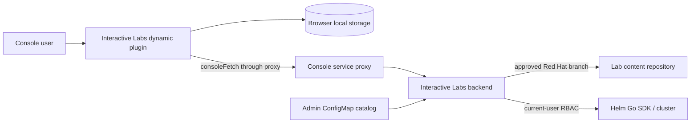
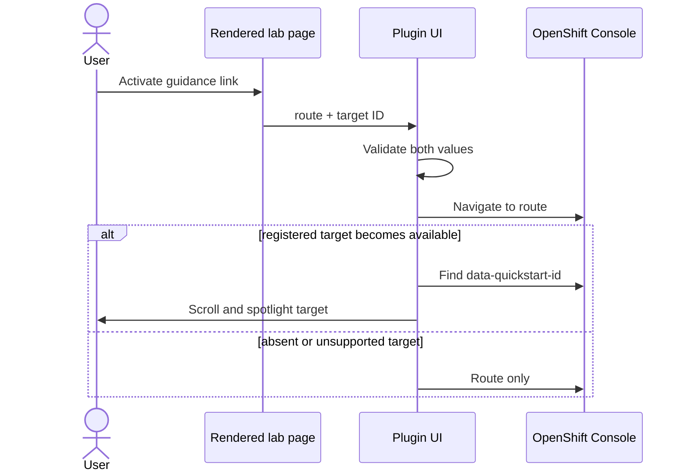

# Architect Notes — Interactive Labs

## Overview

Interactive Labs adds guided, multi-page tasks to OpenShift Console without turning Console, browser, or lab authors into cluster administrators. This note designs client side of MVP and records backend contracts client requires. Product goal and acceptance criteria remain in [proposal.md](proposal.md).

Evidence: `proposal.md`, `stories.md`, and OpenShift Console Dynamic Plugin documentation. STORY-1, STORY-2, and STORY-9 source, tests, and deployment records exist; later-story paths below remain target structure until their story is implemented.

## Design Principles

- **Console-native.** Use Dynamic Plugin SDK, Console navigation, `consoleFetch`, Console service proxy, and existing `data-quickstart-id` targets. Do not recreate Console routing or Quick Starts.
- **Browser is untrusted.** Client never clones arbitrary repositories, runs Helm, stores user tokens, or decides authorization.
- **Content is data, not code.** Lab content comes only from catalog-approved Red Hat branches. MVP does not detect, reconcile, or migrate upstream content updates. Rendering navigates only `labPath/content` pages and loads same-repository supporting resources through backend-approved URLs. The current `type: manual` checkpoint proposal is provisional pending evidence and checkpoint rules.
- **Explicit user intent.** Current namespace-selection proposal requires confirmation; selection and lifecycle policy remain open. Navigation must not claim progress completion.
- **Small MVP.** One lab path, one optional prerequisite chart, and synchronous bounded setup. Browser-local manual progress is a provisional candidate, not a settled completion model. No background worker, CRD, namespace creation, user cancellation, or automated solving.
- **Recoverable failures.** Every lab-content, setup, render, route, and verification failure gives user an actionable manual next step. MVP never retries, cleans up, or recovers Helm automatically.
- **Accessible overlay.** Keyboard operation, focus management, semantic controls, and non-pointer spotlight dismissal are baseline requirements.

## Architecture / How It Works

### Deployment boundary

Console loads browser assets from Dynamic Plugin service. Plugin calls backend only through its declared `UserToken` Console service proxy using `consoleFetch`; backend receives current user's forwarded access token, derives authenticated identity, and performs repository access and Helm operations with current-user RBAC. Dynamic-plugin proxy configuration uses a HTTPS Service endpoint. Backend must not persist or log forwarded tokens. Deployment declares one tested OpenShift Console/Dynamic Plugin SDK compatibility range.



### Backend MVP contract

Backend exposes three operations through the declared `UserToken` Console service proxy. Transport paths are implementation detail; operation semantics below are MVP contract.

| Operation | Client input | Backend requirements | Result |
| --- | --- | --- | --- |
| **List catalog** | None | Read admin-configured approved source entries; derive `catalogRef` before reading each cached snapshot; return validated `lab.yaml` `metadata.displayName` and optional `metadata.description`. Unavailable, missing-manifest, or invalid labs are omitted; unsafe configuration is typed `configuration_error`. | Ordered valid catalog entries or typed catalog/configuration error. |
| **Load lab bundle** | Selected catalog lab ID | Resolve configured repository and branch server-side from immutable hashed snapshot storage; validate supported manifest `apiVersion`; return manifest, current embedded page source map, and optional-chart availability. | Validated bundle plus runtime context, or typed content/version/repository error. |
| **Setup lab** | Selected lab ID and confirmed namespace bindings | Revalidate catalog, bundle, namespace bindings, current-user access, release ownership, and chart inputs. Derive release identity server-side, then run Helm synchronously with `Wait` and bounded timeout. | Terminal `success`, `failure`, or `timeout`, with safe actionable error context. |

Backend must treat catalog repository, branch, lab path, Helm release identity, and authorization identity as server-derived values. Client input must not override them. Forwarded user tokens are request-scoped only: backend must neither persist nor log them.

MVP has no setup cancellation, automatic retry, cleanup, recovery, asynchronous status, durable lab-session state, automated completion verification, or section-solving API. A terminal setup error can leave Helm resources behind and requires manual user or administrator intervention.

### Launch and setup flow

1. **Implemented backend behavior:** Catalog, bundle, and setup loading share one immutable configured repository/branch snapshot at `/var/lib/interactive-labs/cache/<sha256 canonical repository+branch>/content`. `Close` preserves it; no PVC is mounted today, so pod/container replacement loses cache. A future PVC mounts this fixed path. Catalog metadata comes from each validated manifest; no browser resource route exists.
2. **Decided target / planned:** Plugin validates client-facing manifest and page-descriptor shape before using it. Backend remains trust boundary for catalog, branch, paths, and lab-content retrieval. Page navigation uses returned page paths; rendering fetches sources only through returned server-approved URLs. MVP does not check upstream changes during session.
3. Namespace-selection policy remains open. Current provisional direction derives fields from chart metadata, optionally preselects accessible current Console namespace, and requires user confirmation; implementation must not freeze this direction as final policy.
4. Backend derives stable Helm release identity from authenticated user subject, lab ID, configured branch, and normalized namespace bindings: `il-` plus a truncated SHA-256 digest of their canonical representation. Client never supplies release identity; backend derives expected identity again before reusing a release.
5. Plugin calls setup only after confirmation. MVP backend invokes Helm synchronously with `Wait` and bounded timeout, then returns typed final result: `success`, `failure`, or `timeout`.
6. On success—or immediately for lab without chart—plugin opens first page. Any terminal setup error preserves selected context and requires manual intervention by user or administrator. Client neither retries nor guesses cleanup.

MVP uses one bounded request and an indeterminate accessible progress state, not a progress protocol. Closing, minimizing, or resetting panel does not cancel setup. Client exposes no Cancel control: Helm `Install.RunWithContext` can return on context cancellation while a started install continues in background, so cancellation does not reliably mean stop. Backend returns enough error detail to explain RBAC, repository, chart, and timeout failures.

```mermaid
sequenceDiagram
  actor User
  participant UI as Plugin UI
  participant API as Backend through Console proxy

  User->>UI: Select lab
  UI->>API: Get validated manifest
  API-->>UI: Manifest + runtime context
  UI->>User: Select and confirm namespace(s)
  User->>UI: Start lab
  UI->>API: Setup(namespace bindings)
  API-->>UI: success | failure | timeout
  alt success or no chart
    UI->>User: Open first lab page
  else failure or timeout
    UI->>User: Explain outcome; retain selection
  end
```

### Content, routes, and spotlight flow

**Decided target / planned STORY-4:** Plugin renders AsciiDoc in browser through Asciidoctor.js with a restricted, documented profile, then sanitizes generated DOM output. Bundle supplies normalized navigable page paths and server-approved source URLs; ordinary links navigate inside drawer only through known paths under `labPath/content/`, preserving same-page fragments and warning for unknown/external targets. A validated page link activated in catalog description is explicit Launch intent: it validates bundle and opens drawer at target without bypassing chart setup policy. Asciidoctor's include processor requests same-repository includes through backend resource URLs; images use that endpoint after inert rendered HTML has its `src` rewritten. Relative image targets use Asciidoctor's default flattened-document base—the rendered top-level page URL—even when declared in a partial. STORY-4 serves these resources from STORY-9's cached approved snapshot and rejects paths outside the repository. A path with any segment beginning `_` is include-only and cannot be a navigation target; remaining paths sort lexically, with first path as entry page and adjacent paths as previous/next navigation. Runtime attributes supplied by backend override author attributes. Remote includes, executable extensions, arbitrary filesystem access, repository-root escapes, raw HTML outside supported subset, external navigation directives, and arbitrary DOM selectors are rejected.

Asciidoctor safe-mode choice alone does not establish browser XSS safety. Sanitizer policy and permitted AsciiDoc subset are versioned authoring contract; initial fixture supports syntax-highlighted source blocks and Mermaid diagrams, not arbitrary executable extensions or author-supplied SVG. Highlighting consumes text content and rejects unescaped HTML. Mermaid runs with strict security, no auto-start or click/callback binding; generated SVG receives a dedicated sanitizer pass before final DOM sanitization. Recoverable rejected content/resources and Mermaid/highlighter failures render explicit inline warnings; page fetch, conversion, or sanitizer failures render safe actionable page error. Do not share Asciidoctor's global logger across concurrent page/description conversions.

A Quick Start-compatible AsciiDoc macro authors each Console guidance link and carries a same-Console route plus optional symbolic target ID. Plugin translates it to a typed instruction, then validates route and target against Console-supported Quick Start addressing. It navigates first, waits for target render, then finds matching `data-quickstart-id`, scrolls it into view, and displays spotlight. Missing or unsupported target falls back to route-only navigation. Dismiss spotlight on target interaction, Escape, route change, or timeout.



### Panel and progress flow

Overlay state contains active lab/version, current page, panel mode (`open` or `minimized`), namespace bindings, and local section progress. Closing hides panel; explicit user activation reopens valid state. Route remount and browser refresh never auto-open the panel. Reset removes only this browser state. It does not call cleanup, stop setup, delete cluster resources, or alter any future audit record.

Evidence, checkpoint, and completion rules remain open. Current provisional direction is an explicit browser-local `type: manual` checkpoint whose `Confirmed` state is user attestation, not evidence that instructions were completed. Neither page visit nor cached page state may claim confirmation. Browser-local state would be lost when storage is cleared or browser/device changes. Automated verification, solver behavior, and durable progress remain deferred pending this model.

## Core Concepts

| Concept | Role | Client responsibility |
| --- | --- | --- |
| **Catalog entry** | Admin-visible lab locator: approved Red Hat repository, branch, AsciiDoc path, optional chart path, and `lab.yaml` description. | List, select, render description through restricted path using `lab.yaml` base, display availability/error. Never dereference arbitrary URLs. |
| **Lab manifest** | Versioned lab-content contract: attributes, optional setup, links, and typed `checkpoints`. Page paths and entry order derive from loaded content. | Validate schema before use; render only supported features. |
| **Lab session** | Loaded lab bundle plus browser-local state for one selected lab and namespace bindings. | Navigate within loaded bundle; persist/restore panel and progress state. |
| **Namespace binding** | Provisional mapping from chart release namespace or annotated chart value to a namespace. | Do not treat current explicit-selection approach as settled policy. |
| **Helm release identity** | Server-derived identity for one user's deployment of one configured lab branch into one normalized set of namespace bindings. | Never generate, persist as authority, or submit it; use it only as backend-provided correlation context. |
| **Setup result** | Final backend result for optional Helm prerequisite installation. | Show typed status and safe next action. |
| **Lab page** | One lab-local AsciiDoc page. | Resolve allowed relative links; show loading, missing-page, malformed-content states. |
| **Console guidance link** | Typed `{ route, targetId? }` instruction using Console-supported Quick Start addressing, not URL/selector escape hatch. | Validate, navigate, attempt spotlight, fallback safely. |
| **Checkpoint** | Provisional typed section-progress marker; current candidate is `type: manual`. | Never present user attestation as automated verification or settled completion evidence. |

### Lab content delivery

**Implemented and verified:** Catalog identifies a lab by canonical approved Red Hat repository identity and branch. Backend shallow-clones one immutable snapshot per identity on first use into `/var/lib/interactive-labs/cache/<sha256 canonical repository+branch>/content`, then reuses it for catalog metadata, bundle, and setup loading while cache storage remains. Entry directory is reserved for future metadata. `Close` does not remove snapshots; current deployment has no PVC, so pod/container replacement or cache clearing permits a new snapshot. Future PVCs mount this fixed path. Backend returns no revision and does not detect upstream changes. An unavailable repository, missing manifest, or invalid lab is omitted from catalog with one safe Warning Event per `(catalogRef, reason)` for backend lifetime.

**Decided target / planned STORY-4:** Browser never selects or fetches arbitrary repository content: it loads page, include, and image sources only through backend-approved URLs. At lab launch, backend reads manifest, navigable pages under `labPath/content`, and optional chart from cached approved snapshot; resource requests reject paths outside that repository. Helm dependencies may resolve at runtime from sources declared by approved chart; catalog approval trusts those declarations. MVP does not expose resolved revision, detect an upstream update, migrate state, or reconcile running labs after upstream content changes.


### Provisional namespace direction

Namespace selection and lifecycle for single and multiple namespaces remain open. Current candidate uses an explicit release-namespace selector plus `values.schema.json` fields annotated `x-interactive-labs: { "kind": "namespace-name" }` for additional inputs. Property path would be binding key; standard `title`, `description`, and `required` would drive UI. This is not final authoring or lifecycle policy.

Current candidate asks user to bind each selector to an existing namespace and may preselect accessible current Console namespace. It does not create namespaces or choose them silently; multiple selectors may choose same namespace. Revisit these rules when resolving namespace policy rather than treating them as acceptance criteria.

### State ownership

| State | Owner | Persistence |
| --- | --- | --- |
| Catalog validation, lab-content retrieval, setup, authorization | Backend | Backend-defined operational state |
| Current user/namespace/routing | OpenShift Console | Console |
| Overlay/page/minimized state | Plugin | Namespaced browser local storage |
| Provisional `type: manual` checkpoint | Plugin | Candidate: browser local storage; user attestation only |

Local storage key must include lab identity and configured branch. On manifest incompatibility or reset, discard incompatible client state rather than attempting migration.

### Future asynchronous setup

Asynchronous setup is feasible without a durable operation ID: Helm release identity is correlation key, and Helm release state is source for later status/recovery. One release may have zero or one active deployment. A future `POST /setup` can return while backend runs; a later authenticated browser request with a fresh token asks for same release state or explicitly re-deploys it. That future work is independent of upstream branch-update handling.

That future path needs release-scoped mutual exclusion across backend replicas—Kubernetes `Lease` is smallest durable option—and a server-side deadline. While lease is held or Helm reports `pending-*`, response is `in_progress`; expired/missing lease plus pending release is abandoned and requires explicit user-authorized recovery. No token, operation log, or cancellation record needs persistence. This remains future work; MVP is synchronous.

## Implementation Plan

### Phase 1 — Establish plugin shell and contracts

- Bootstrap from supported OpenShift Console Dynamic Plugin template; declare ConsolePlugin asset hosting and HTTPS service proxy.
- Pin compatible Dynamic Plugin SDK and PatternFly/Console dependency set; use SDK hooks rather than directly sharing QuickStart React context across plugin boundary.
- Define TypeScript schemas for catalog view, `v1alpha1` manifest view, setup result, chart namespace annotations, guidance links, typed checkpoints, and persisted session.
- Backend and plugin reject unsupported manifest `apiVersion`; agree error envelope before UI implementation. No migration framework in MVP.

### Phase 2 — List catalog labs (STORY-2)

- Build catalog listing on `InteractiveLabsPage` with loading, empty, typed-error, and retry states.
- Render each approved catalog entry with a keyboard-accessible disabled Launch button.
- Do not load bundles, persist sessions, run setup, render a drawer, or render content.

### Phase 3 — Launch and persistent sliding drawer (STORY-3)

- Enable Launch, load and validate selected lab bundle, and open first navigable page immediately only when no chart is available.
- Build accessible side drawer shell with open/minimize/restore/close/reset and browser-state restore; do not trap focus because Console remains usable beside drawer.
- Test keyboard controls, focus movement/restoration, bundle errors, and reset's no-cluster-mutation boundary.

### Phase 4 — Render and navigate content (STORY-4)

- After STORY-9 cached snapshots, add restricted Asciidoctor.js adapter that fetches page and same-repository include sources through backend-approved URLs; retain runtime-attribute precedence.
- Add page navigation and invalid content/missing-resource states. Console guidance links and spotlight remain STORY-6 scope.

### Phase 5 — Verify and harden representative lab (STORY-8)

- Implement checkpoints only after evidence and checkpoint rules are decided. Current `type: manual` browser-local design is provisional; navigation must not claim completion.
- Add unit tests for schema/link/state rules, component tests for overlay/render/error states, accessibility tests, proxy/backend integration tests, and an OpenShift smoke test.
- Publish author/admin contract, supported Console range, RBAC needs, recovery guidance, and one complete fixture lab.

## Deferred to V2

- **Lab author validation tool.** Validate lab content, manifest, chart `values.schema.json` namespace annotations, and Helm chart before publication.
- **Verification and solver model.** Decide evidence, checkpoint, automated-verification, and section-solver rules before adding non-manual checkpoint types.
- **Asynchronous setup lifecycle.** Add release lease, status/recovery UI, and server-side deadline when synchronous setup no longer meets user needs.
- **Upstream-content lifecycle.** Add revision visibility, update notification, migration/reconciliation, and rollback behavior for branch-delivered lab content.
- **Offline/change-controlled delivery.** Add digest-published lab content for disconnected or tightly governed clusters.

## Open Questions

## ✔ Q1: Proxy authorization and compatibility target

Dynamic Plugin proxy configuration determines what reaches backend and which Console/SDK APIs plugin can rely on.

### Option A: `UserToken` proxy authorization with one declared OpenShift/Console compatibility range
- **Pro:** Meets current-user RBAC requirement; smallest support/test matrix.
- **Con:** Requires backend token handling discipline and range upgrades.

**Decision:** Option A — use `consoleFetch`, avoid token persistence/logging, and publish one tested compatibility range.

_Considered and rejected: Option B (adds privileged identity and impersonation risk while breaking direct user-RBAC execution.)_

## ✔ Q2: Setup retry and partial-install lifecycle

A timed-out or failed Helm operation can leave resources behind. A client retry or cleanup request cannot be treated as harmless without a chart-specific recovery contract.

### Option C: No automatic retry in MVP
- **Pro:** Avoids accidental duplicate setup, hidden cleanup, and unsafe recovery assumptions.
- **Con:** Every terminal setup error needs user or administrator intervention before a new request.

**Decision:** Option C — MVP never retries, cleans up, or recovers Helm automatically. User or administrator diagnoses and remediates the error; any later explicit setup request uses a fresh token and backend release-state checks.

_Considered and rejected: Option A (would imply productized recovery policy before chart lifecycle is defined), Option B (can compound partial installs and hides cleanup responsibility.)_

## ✔ Q3: Rendered-content trust and sanitization

Pinned repositories reduce supply-chain drift but do not make HTML emitted into Console safe by default. This decision sets content-author capability.

### Option A: Strict authoring subset plus DOM sanitization
- **Pro:** Best XSS boundary; portable and testable contract.
- **Con:** Limits rich AsciiDoc/HTML features and needs sanitizer configuration.

**Decision:** Option A — support only fixture-lab AsciiDoc subset, sanitize rendered DOM, and expand author capability only after security review.

_Considered and rejected: Option B (approved repository compromise can inject into Console), Option C (cross-frame navigation, styling, and accessibility complexity.)_

## ✔ Q4: Guidance-link syntax and target registry owner

Authors need stable links while Console DOM remains private implementation. Console's Quick Start addressing is supported; any other content-addressing mechanism is unsupported and unstable.

### Option A: Quick Start-compatible AsciiDoc macro and Console-supported target registry
- **Pro:** Typed, lintable, and stable within supported Console contract; no raw routes/selectors; target behavior matches Quick Starts.
- **Con:** New target support follows Console/Quick Start support and may require plugin release.

**Decision:** Option A — lab guidance uses Quick Start-compatible symbolic target IDs mapped to supported route and `data-quickstart-id` behavior. Unsupported target ID falls back to route-only navigation.

_Considered and rejected: Option B (author-controlled target definitions cannot guarantee supported/stable Console addressing), Option C (arbitrary selectors/routes are unsupported and unstable.)_

## ☐ Q5: Evidence, checkpoint, and section-solver rules

Labs need an honest way to describe progress and, if supported later, prove completion or solve a section. Arbitrary manifest checks risk becoming an ad-hoc execution language.

### Option A: Typed browser-local manual checkpoint (provisional)
- **Pro:** Smallest initial user-attestation experience; avoids premature check DSL and arbitrary cluster-query surface.
- **Con:** `Confirmed` does not prove instructions were completed and does not define automated verification or solver behavior.

**Recommendation:** Retain Option A only as provisional exploration while defining valid evidence, checkpoint types and semantics, automated-verification boundaries, and section-solver behavior. Do not make checkpoint behavior an MVP contract yet.

**Scope impact:** Do not treat the provisional manual checkpoint as satisfying observable-check acceptance criteria.

## ✔ Q6: Progress durability and audit scope

Browser-local state satisfies close/reopen on one browser but disappears on cleared storage and does not support instructors/audit.

### Option A: Browser-local only for MVP
- **Pro:** Matches current scope; no new storage, identity, or privacy system.
- **Con:** No cross-device resume or audit trail.

**Decision:** Store panel state in browser local storage. If provisional manual checkpoints are retained after Q5, keep their state browser-local and do not claim durable completion history.

_Considered and rejected: Option B (adds persistence, authorization, retention, and reset semantics before MVP needs them.)_

## ☐ Q7: Namespace selection and lifecycle

Charts can target one release namespace and, through values, additional namespaces. Product needs a consistent selection and lifecycle policy for both cases.

### Option A: Explicit existing-namespace bindings from chart schema (provisional)
- **Pro:** Chart-local inputs can drive a visible selection UI without brittle template inference or duplicated manifest namespace lists.
- **Con:** Does not yet resolve selection/lifecycle policy, and introduces `x-interactive-labs` authoring convention that backend must validate.

**Recommendation:** Retain Option A only as provisional exploration while deciding selection and lifecycle rules for one and multiple namespaces. Current candidate uses explicit release-namespace selection plus `values.schema.json` fields marked `x-interactive-labs: { "kind": "namespace-name" }`; property path is binding key, current namespace may preselect when accessible, and multiple inputs may share a namespace.

## ✔ Q8: Manifest and API evolution policy

Plugin, backend, and lab content update independently. Version mismatch must fail predictably rather than partially render or install.

### Option A: Semantic manifest `apiVersion`; backend rejects unsupported versions; plugin rejects unsupported capabilities
- **Pro:** Clear compatibility/error behavior; permits additive evolution.
- **Con:** Needs schema/version maintenance.

**Decision:** Option A — support one `v1alpha1` manifest in MVP. Backend and plugin reject unsupported versions; no general migration framework.

_Considered and rejected: Option B (branch-delivered lab content could silently break as format evolves.)_

## ✔ Q9: Lab repository and Helm dependency delivery

Red Hat authors labs, but many independent customer clusters consume them. Requiring each customer administrator to promote every content fix defeats centrally maintained lab content.

### Option B: Catalog references approved Red Hat branch; MVP does not handle upstream updates
- **Pro:** Smallest author and customer workflow; Red Hat can update branch without customer ConfigMap edits.
- **Con:** No reproducibility, update notification, migration, rollback, or running-lab reconciliation guarantee beyond content already loaded for current overlay.

**Decision:** Option B — MVP references approved Red Hat branch and loads one lab bundle at launch. It does not pin or surface commit IDs, observe/update active sessions, or reconcile content changed upstream. Helm dependencies may resolve at runtime from sources declared by approved chart; catalog approval trusts those declarations.

_Considered and deferred: Option A (per-customer commit promotion), Option C (digest-packaged/offline distribution), branch-to-commit session snapshots and upstream-update lifecycle management._
